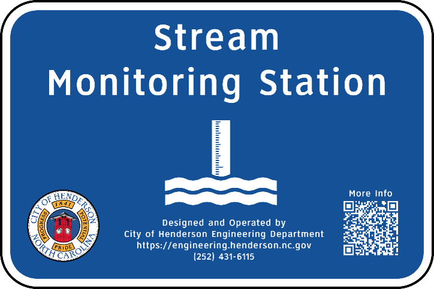
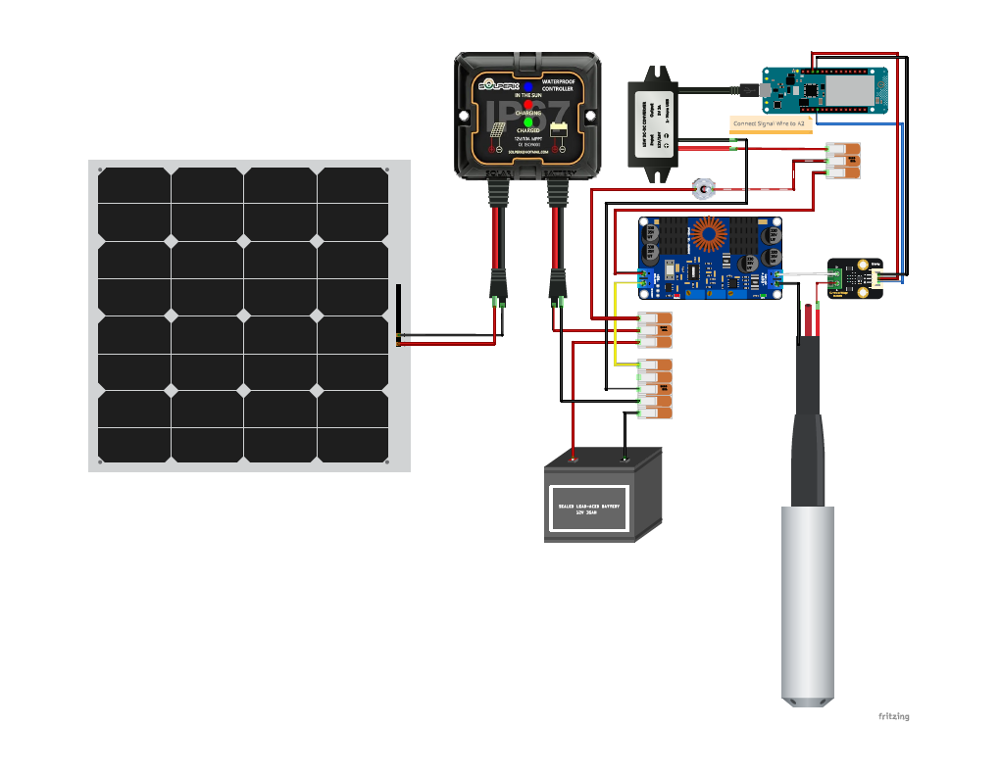

# Creeklytics Stormwater Station

Creeklytics Stormwater Station is a solar-powered stream water-level monitoring station developed by the City of Henderson Engineering Department.

## Design files

| Folder | Files | Purpose |
| --- | --- | --- |
| [`hardware/pcb/`](https://github.com/CityofHenderson/Creeklytics-Stormwater-Station/tree/main/hardware/pcb) | Fritzing wiring design and schematic PDF | Shows how the pressure transducer, signal converter, Arduino, and power supplies connect. Open the Fritzing file to edit the design or use the PDF to review the wiring. |
| [`hardware/step/`](https://github.com/CityofHenderson/Creeklytics-Stormwater-Station/tree/main/hardware/step) | Pressure-probe mounting bracket and probe cap with grommet mount, both in STEP format | Defines the printable parts for the nominal 2-inch PVC probe housing. The design uses two brackets and one cap, printed in PETG. |
| [`firmware/`](https://github.com/CityofHenderson/Creeklytics-Stormwater-Station/tree/main/firmware) | Creeklytics Arduino sketch and companion source files | Runs on the Arduino MKR NB 1500. The firmware samples the analog signal, calculates water depth, and reports readings to Arduino Cloud over cellular. |

## Electrical design

A submersible 4–20 mA pressure transducer measures water depth. A SEN0262 current-to-voltage converter feeds the transducer signal to an analog input on the Arduino MKR NB 1500. A solar panel and 12 V battery supply the station, with separate regulated supplies for the pressure transducer and the Arduino’s 5 V power input. Use the wiring schematic for the connections between modules.

### Wiring Diagram

## Mechanical design

The two brackets secure the PVC probe housing to the mounting surface. The cap holds a rubber grommet where the sensor cable exits the housing, protecting the cable from abrasion. Open the STEP models in a CAD tool to inspect the fit or prepare the parts for printing.

### Bill of Materials

| Designator | Component | No. |
| --- | --- | --- |
| Controller | Arduino MKR NB 1500 (NB-IoT/LTE-M, SAMD21) | 1 |
| Sensor | Gravity submersible liquid-level (4-20 mA) pressure sensor | 1 |
| Signal converter | SEN0262 current-to-voltage module (0-25 mA to 0-3 V) | 1 |
| Power | Solar panel and charge controller | 1 |
| Power | 12 V 8 Ah battery (lead-acid; see LiFePO4 upgrade) | 1 |
| Enclosure | Weatherproof rated enclosure | 1 |
| Connectors | 4-pin waterproof DIN connectors | 3 |
| Connectors | 2-pin waterproof DIN connector | 1 |
| Connectors | WAGO connector variety pack | 1 |
| Power | 12 V to 5 V regulator | 1 |
| Power | DC-DC buck-boost converter (sensor supply) | 1 |
| Antenna | Antenna mount with BNC connector | 1 |
| Signage | Stormwater program sign | 1 |
| Structure | Sign post | 1 |
| Probe | 2-inch PVC pipe (probe housing) | 1 |
| Conduit | 1-inch conduit, 10 ft | 1 |
| Conduit | 1-inch conduit elbow | 2 |
| Conduit | 1-inch conduit 90 deg | 2 |
| Brackets | 3D-printed parts (PETG) | - |
| Fasteners | 1/2-inch wedge anchors | 4 |
| Tooling | 1/2-inch masonry bit | 1 |
| Hardware | Various loose hardware | - |
| Wiring | 3-wire 18 AWG wire | 1 |

## Licensing

